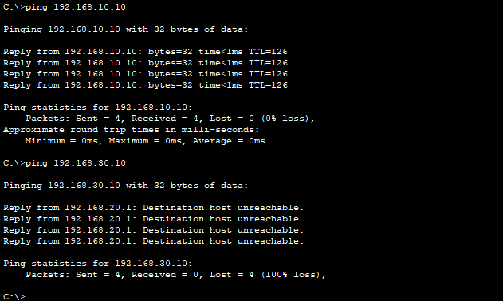
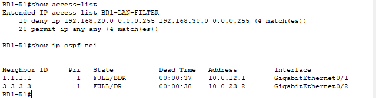
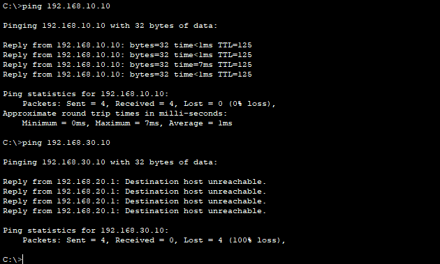
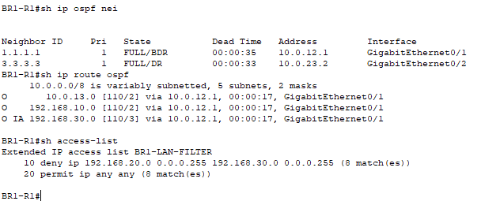

# Multisite ACL Segmentation Lab

## Overview

I extended my three-site OSPF network in Cisco Packet Tracer by applying a named extended ACL to BR1's LAN interface. The objective was to block IPv4 traffic from the BR1 LAN to the BR2 LAN while preserving connectivity to HQ and keeping OSPF neighbors operational.

I tested the policy with the normal WAN path, disabled BR1's direct link to HQ, repeated the endpoint tests over the backup path, and restored the preferred route.

This is a guided personal lab completed by Michael Bessard to build practical network engineering and cybersecurity skills.

## Lab environment

- Cisco Packet Tracer 8.2.2.
- Three Cisco 2911 routers, three Cisco 2960 switches, and three PCs.
- OSPF process 1 with the WAN links in area 0.
- BR1 LAN in area 10 and BR2 LAN in area 20.
- Branch-to-branch backup link with OSPF cost 100 on both endpoints.

The underlying design is documented in my [Multisite OSPF Deployment Lab](https://github.com/mikemsb81/multisite-ospf-deployment).

## Addressing and paths

| Site | LAN | PC address | Gateway |
| --- | --- | --- | --- |
| HQ | 192.168.10.0/24 | 192.168.10.10 | 192.168.10.1 |
| BR1 | 192.168.20.0/24 | 192.168.20.10 | 192.168.20.1 |
| BR2 | 192.168.30.0/24 | 192.168.30.10 | 192.168.30.1 |

| WAN link | Endpoints |
| --- | --- |
| HQ–BR1 | HQ G0/1: 10.0.12.1/30; BR1 G0/1: 10.0.12.2/30 |
| HQ–BR2 | HQ G0/2: 10.0.13.1/30; BR2 G0/1: 10.0.13.2/30 |
| BR1–BR2 backup | BR1 G0/2: 10.0.23.1/30; BR2 G0/2: 10.0.23.2/30 |

Normal traffic from BR1 to the remote LANs prefers the route through HQ. When BR1 G0/1 is disabled, permitted traffic to HQ travels through BR2. The ACL remains on BR1 G0/0, where traffic enters from the local LAN, so its placement covers either WAN path.

## Policy and configuration

| IPv4 packet entering BR1 G0/0 | Action |
| --- | --- |
| Source 192.168.20.0/24, destination 192.168.30.0/24 | Deny |
| All other IPv4 traffic | Permit |

Configuration applied on BR1-R1:

```text
configure terminal
ip access-list extended BR1-LAN-FILTER
deny ip 192.168.20.0 0.0.0.255 192.168.30.0 0.0.0.255
permit ip any any
exit
interface gigabitEthernet0/0
ip access-group BR1-LAN-FILTER in
end
```

The wildcard mask `0.0.0.255` matches the complete /24 subnet. Entries are checked in order; the first matching rule determines the action. The explicit permit after the deny preserves other traffic that would otherwise encounter the ACL's implicit deny.

This is a targeted restriction with a broad permit for everything else, rather than a default-deny policy. OSPF neighbor traffic uses the WAN interfaces and does not enter through the filtered LAN interface.

## Validation results

Before applying the ACL, I confirmed that BR1-PC1 could ping both HQ-PC1 and BR2-PC1.

| Test | HQ-PC1: 192.168.10.10 | BR2-PC1: 192.168.30.10 |
| --- | --- | --- |
| Before ACL | Ping successful | Ping successful |
| ACL applied, normal path | 4 replies, 0% loss | 0 replies, 100% loss |
| ACL applied, direct HQ link disabled | 4 replies, 0% loss | 0 replies, 100% loss |

The blocked tests displayed destination-host-unreachable messages from BR1's gateway, 192.168.20.1. ACL deny matches provided additional evidence that the rule was filtering the packets.

### Normal-path policy test



After the first test, the deny entry recorded four matches and the permit entry recorded four matches. BR1's neighbors with HQ (router ID 1.1.1.1) and BR2 (3.3.3.3) both remained FULL.



### Policy during WAN failover

I disabled BR1 G0/1, allowed routing to converge, and repeated both pings from BR1-PC1. HQ remained reachable, while BR2-PC1 remained blocked.



### Recovery

After restoring BR1 G0/1, both OSPF neighbors were FULL. The HQ LAN route returned to next hop 10.0.12.1 with cost 2, and the BR2 LAN route returned to 10.0.12.1 with cost 3 as an OSPF inter-area route (`O IA`). The ACL showed eight deny matches and eight permit matches across the two test rounds.



## Repeat the test

Download [multisite-acl-segmentation.pkt](multisite-acl-segmentation.pkt) and open it in Packet Tracer. The saved project contains the ACL with the direct HQ link restored.

1. On BR1-R1, check the policy and routing state:

   ```text
   show access-lists
   show ip interface gigabitEthernet0/0
   show ip ospf neighbor
   show ip route ospf
   ```

2. From BR1-PC1, verify that HQ responds and BR2-PC1 is blocked:

   ```text
   ping 192.168.10.10
   ping 192.168.30.10
   ```

3. On BR1-R1, disable the direct HQ link:

   ```text
   configure terminal
   interface gigabitEthernet0/1
   shutdown
   end
   ```

4. Allow convergence, check the routes, and repeat the PC pings. Permitted traffic should use the backup link while the restriction remains effective.
5. Restore the direct link:

   ```text
   configure terminal
   interface gigabitEthernet0/1
   no shutdown
   end
   ```

6. Verify the neighbors, preferred routes, and ACL counters again. Counter values depend on traffic since the last reset or reload; compare their changes rather than expecting exactly eight matches.
7. Save the restored configuration with `copy running-config startup-config`, then save the Packet Tracer project.

## ACL direction and limitations

This ACL evaluates individual IPv4 packets; it does not track connections. A BR1-to-BR2 packet is denied whether it is a new request or a reply to traffic initiated from BR2. For example, a ping initiated by BR2-PC1 toward BR1-PC1 would also be expected to fail because BR1-PC1's echo reply matches the deny rule. That reverse-direction test was not performed in this lab.

The ACL does not provide complete bidirectional isolation: a packet traveling from BR2 toward BR1 is not directly denied by this inbound LAN ACL. A policy that allows sessions initiated in one direction while permitting only their return traffic would require additional design, such as stateful firewall inspection.

The configured rule denies all matching IPv4 traffic, but the endpoint tests here used ICMP ping only. TCP, UDP, IPv6 filtering, spoofing resistance, and stateful inspection were outside this lab's scope. Convergence time and packet loss at the instant of link failure were not measured.

## Rollback

To remove enforcement while retaining the ACL definition, on BR1-R1 enter:

```text
configure terminal
interface gigabitEthernet0/0
no ip access-group BR1-LAN-FILTER in
end
```

To enforce it again, reapply `ip access-group BR1-LAN-FILTER in` on G0/0. The rollback procedure is provided for repeatability; it was not part of the recorded test sequence.

## What I learned

- A route can exist while an ACL intentionally blocks traffic to its destination.
- ACL counters help distinguish policy enforcement from a routing outage.
- Interface placement and direction matter as much as the rule itself.
- Security policy should be checked on both preferred and backup paths.
- Testing allowed traffic alongside blocked traffic helps detect unintended disruption.
